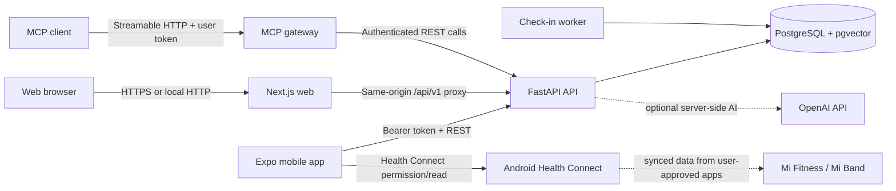

# Sakuna AI — System Documentation

**Document date:** 12 November 2026  
**Purpose:** describe the repository's current system, how to run it, and which capabilities are still planned or require device/deployment validation.

> This document describes the code and project notes currently in this repository. Screenshots and product ideas are not evidence that a feature is implemented. Where older Markdown files disagree, the current source files and `PROJECT_STATUS.md` take precedence; see [Documentation alignment](#documentation-alignment).

## 1. Product overview

Sakuna AI is a personal life operating system intended to bring daily planning, capture, goals, habits, personal records, and an AI assistant into one account. It has a responsive web client, an Android/iOS Expo client, a FastAPI backend, PostgreSQL storage, an optional AI provider integration, a separate Model Context Protocol (MCP) gateway, and a background check-in worker.

The backend is the source of truth for account records. Clients authenticate to the API and access records scoped to the signed-in user. The AI can summarize account data and propose actions. Actions that use the approval flow remain pending until the user approves them.

## 2. Repository map

```text
sakuna-ai/
├── apps/
│   ├── web/                 Next.js web app
│   └── mobile/              Expo / React Native application
├── backend/
│   ├── app/api/v1/           REST endpoints
│   ├── app/core/             Settings, database, JWT and dependencies
│   ├── app/models/           SQLAlchemy data models
│   ├── app/schemas/          Request and response validation
│   ├── app/services/         Assistant, planner, memory, finance, permissions
│   ├── app/workers/          Reminder and check-in worker
│   └── alembic/              Database migrations
├── mcp-service/              MCP Streamable HTTP gateway
├── docs/                     Architecture, API, privacy and integration notes
├── infra/                    Reverse-proxy example
├── docker-compose.yml        Local database and service orchestration
├── .env.example              Safe environment variable template
├── PROJECT_STATUS.md         Current implementation/verification notes
└── IMPLEMENTATION_ROADMAP.md Planned work by sprint
```

The web UI currently uses a single Next.js App Router shell that switches among modules. Module labels in the navigation are not necessarily separate URL routes. The mobile app currently has Home, Plan, Capture, AI, Health, Focus and Profile tabs.

## 3. System architecture



### Services

| Service | Location | Role |
|---|---|---|
| Web | `apps/web` | Responsive dashboard and life-management screens; authenticated API client and token refresh. |
| Mobile | `apps/mobile` | Quick capture, plan, assistant, health and focus workflows. Expo; native Android build is required for Health Connect. |
| API | `backend` | Authentication, validation, user-scoped business logic, REST resources and database access. |
| Database | Compose `db` | PostgreSQL 16 with pgvector extension. Persistent data is held in the `sakuna_pg` volume. |
| Worker | `backend/app/workers` | Background check-in/reminder processing. |
| MCP | `mcp-service` | Narrow allowlist of tools that call the API as the authenticated user. It does not query the database. |

### Request and trust boundaries

- Only the backend accesses the database. API routes enforce ownership using the authenticated user's ID.
- Web requests go through a same-origin `/api/v1` proxy in the Docker web build. Mobile requests use `EXPO_PUBLIC_API_URL` compiled into the app.
- MCP validates/forwards the user's Sakuna bearer token. MCP write tools create pending approval records rather than directly changing account data.
- `OPENAI_API_KEY` belongs only in the backend environment. Never put provider credentials in web/mobile bundles or commit them.
- Health records are sensitive data. The phone reads only permitted data types and uploads only after the user taps the sync action.

## 4. Current application areas

The API and clients cover these areas to varying degrees. A listed resource means the corresponding route/module exists; it does not promise every long-term product feature is complete.

| Area | Current purpose |
|---|---|
| Account and profile | Registration, login, refresh/logout, current-user profile. |
| Overview/dashboard | Account summaries and daily snapshot. |
| Assistant and conversations | Account-aware chat, conversation history, optional voice transcription. Without an AI key, chat falls back to local factual summaries; it is not a general-purpose hosted model. |
| Capture inbox | Save unprocessed capture items and review/confirm them. |
| Tasks, goals and habits | User-owned records, task completion, goal tracking and habit logs. |
| Planner | Daily/weekly views and generated plan items. Treat generated work as proposals unless the UI/API records an actual completed action. |
| Memory | Create, search, update and delete saved memories. PostgreSQL can use pgvector embeddings; SQLite development uses text matching. Sensitive-pattern memory is not saved unless opted into. |
| Finance | Income, expenses, assets, liabilities, summaries and reports. Actual, estimated and projected records are kept distinct; different currencies are not converted or combined. |
| Career | Career profile, jobs and projects. |
| Health | Normalized health records, sleep and workout resources, summaries and activity history. Mobile Health Connect can supply an opt-in subset (see below). Health summaries are not medical advice. |
| Focus | Focus sessions; the mobile client also includes a local in-app timer. It does not block other apps or websites. |
| Check-ins and notifications | Check-in settings/history and in-app notification/reminder support. Actual push delivery still needs deployment configuration. |
| Approvals | Review and approve/reject pending proposed writes, including MCP write requests. |

## 5. AI, memory and action safety

The assistant can use authenticated account summaries and saved memories to contextualize requests. With a valid backend `OPENAI_API_KEY`, the configured model settings enable provider-backed responses, embeddings and transcription as configured. Without the key, local summary and keyword-search fallbacks are available; voice transcription is unavailable.

AI suggestions are not proof that a task was created or completed. Capture confirmation and approval flows are used where present. The MCP service permits read tools and approval-only writes. Consequential external integrations, a universal autonomous agent, calendar automation and publishing workflows are not complete production capabilities.

## 6. Health Connect and Mi Band 10

### Data path

```text
Mi Band 10 → Mi Fitness sync → Health Connect → Sakuna Android app (permission + read)
           → explicit user sync → POST /api/v1/health/... → Sakuna backend/database
```

The band does not send data directly to the laptop backend. Mi Fitness must write supported metrics into Health Connect; Sakuna then reads permitted records from Health Connect on the Android phone and sends normalized records to the API when the user explicitly starts sync.

### Currently configured mobile behavior

- Android Health Connect integration is implemented using `react-native-health-connect` and requires a custom native Android build; Expo Go cannot load this native integration.
- The app requests read access for Steps, HeartRate and SleepSession. Access is optional and user-controlled.
- The current read adapter aggregates today's steps, reads the latest heart-rate sample for today, and finds the latest completed sleep session in a 36-hour lookback.
- Sync is user-initiated; the code does not run a background health sync.
- The API accepts normalized health records at `POST /api/v1/health/records`, `/health/sleep` and `/health/workouts`.
- Metric availability depends on Mi Fitness, region, Health Connect provider version, Android version and granted permissions. In particular, all-day heart rate may not be available from this source. Missing data is not evidence of a failed backend request.
- Health Connect requires a compatible Android device; on Android 13 or earlier, the Health Connect app may need to be installed separately. There is no iOS Health Connect implementation here.

### Setup/check sequence

1. Pair the Mi Band 10 in Mi Fitness and sync it there.
2. In Mi Fitness, enable supported Health Connect / third-party data sync. Xiaomi's menu and available data types may vary by app version and region.
3. Confirm Mi Fitness has written data in Health Connect and inspect Health Connect's app permissions.
4. Install and open a Sakuna custom Android build, sign in, open Health, connect Health Connect, and grant only the types you want to share.
5. Tap the explicit sync control. Check the API/server logs or Health view for acceptance.

No wearable data should be represented as synced until the phone has read it and the API accepts it.

## 7. API guide

Base path: `/api/v1`. Authenticated routes use `Authorization: Bearer <access-token>`. Login/registration returns a short-lived access token and a rotating refresh token. Exact schemas are defined by the backend and interactive OpenAPI is available at `/docs` while the API runs.

| Resource | Main route groups |
|---|---|
| Account | `/auth/register`, `/auth/login`, `/auth/refresh`, `/auth/logout`, `/me`, `/profile` |
| Dashboard | `/dashboard`, `/dashboard/summary` |
| Assistant | `/chat`, `/conversations`, `/voice/transcribe` |
| Capture | `/capture`, `/capture/{id}/confirm` |
| Tasks/goals | `/tasks`, `/tasks/{id}`, `/tasks/{id}/complete`, `/goals` |
| Planner | `/planner/generate`, `/planner/daily`, `/planner/weekly`, `/planner/items/{id}` |
| Memory | `/memories`, `/memories/{id}`, `/memories/search` |
| Finance | `/finance/income`, `/finance/expenses`, `/finance/assets`, `/finance/liabilities`, `/finance/summary`, `/finance/reports` |
| Career | `/career/profile`, `/career/jobs`, `/career/projects` |
| Health | `/health/records`, `/health/sleep`, `/health/workouts`, `/health/summary`, `/health/activity` |
| Habits/focus | `/habits`, `/habits/{id}/logs`, `/focus/sessions`, `/focus/sessions/{id}/finish` |
| Check-ins/approvals | `/checkins/settings`, `/checkins/history`, `/approvals`, `/approvals/{id}/approve`, `/approvals/{id}/reject` |

See [`docs/api.md`](docs/api.md) and the running OpenAPI schema for current details. Finance requests require explicit currency codes; no exchange rate conversion is inferred.

## 8. Local web/API stack

### Requirements

- Docker Desktop with its Linux engine running (for Compose), or Python/PostgreSQL for a manual backend setup.
- Node.js for the mobile and web development workflows; the mobile README specifies Node.js 22.13 or newer.
- A real OpenAI API key is optional and belongs only in the ignored root `.env` file.

### Docker Compose

From the repository root in PowerShell:

```powershell
Copy-Item .env.example .env
# Edit .env: use strong, unique JWT_SECRET and SERVICE_TOKEN values.
docker compose up --build
```

Then open:

- Web: `http://localhost:3000`
- API health: `http://localhost:8000/health`
- API/OpenAPI docs: `http://localhost:8000/docs`
- MCP health: `http://localhost:8100/health`
- MCP endpoint: `http://localhost:8100/mcp`

Compose starts PostgreSQL, applies Alembic migrations through the backend startup, then starts API, worker, MCP and web services. Stop with `Ctrl+C`; use `docker compose down` to stop/remove containers. The named database volume persists data. `docker compose down -v` deletes that database volume; use only if you intend to erase local data.

If Docker reports that `dockerDesktopLinuxEngine` pipe cannot be found, Docker Desktop is not running or has not finished starting. Start Docker Desktop, wait for the Linux engine to report ready, then rerun Compose. The Compose stack is not required just to preview static frontend work, but authenticated app features need the API and database.

### Backend without Docker

Use Python 3.12, install `backend/requirements.txt`, configure `DATABASE_URL` to PostgreSQL or local SQLite, then from `backend/`:

```powershell
alembic upgrade head
uvicorn app.main:app --reload
```

PostgreSQL with the vector extension is required for pgvector semantic memory. SQLite is for local development and uses text memory matching.

## 9. Web and phone connectivity

The web UI is part of Compose. For a physical phone to reach a laptop backend, the phone and laptop must be on a network that routes between them, and Windows Firewall must allow inbound TCP port 8000. Set `EXPO_PUBLIC_API_URL` in `apps/mobile/.env` to the laptop's current Wi-Fi/hotspot IPv4 address, for example:

```dotenv
EXPO_PUBLIC_API_URL=http://192.168.18.9:8000
```

The address shown by `ipconfig` can change; use the active adapter's current IPv4 address. When the laptop uses the phone hotspot, both are on the same local network, so this LAN address is the right pattern. The phone's mobile-data internet does not by itself make the laptop backend publicly reachable. Do not expose the development API directly to the public internet; use HTTPS and an authenticated deployment for remote access.

Android emulator uses `http://10.0.2.2:8000`. Expo embeds `EXPO_PUBLIC_API_URL` into the app at build time; rebuild after changing the address. The web build uses a same-origin API proxy and does not use the mobile URL.

## 10. Android APK build and install

The project provides `apps/mobile/build-apk.ps1` and `npm run build:apk`. The script expects Android SDK Command-line Tools at `%LOCALAPPDATA%\Android\Sdk\cmdline-tools\latest\bin\sdkmanager.bat`, an available JDK (the script prefers `C:\Program Files\Java\jdk-21` when `JAVA_HOME` is unset), Node dependencies, accepted SDK licenses, and the Android SDK packages listed below.

From PowerShell:

```powershell
cd D:\cursor\sakuna-ai\apps\mobile
npm install
# Set EXPO_PUBLIC_API_URL in .env before building for a physical phone.
npm run build:apk
```

The script checks/installs platform-tools, Android platform `android-37.0`, Build Tools `37.0.0` and NDK `27.0.12077973`, then runs Gradle `assembleDebug`. Expected output:

```text
apps/mobile/android/app/build/outputs/apk/debug/app-debug.apk
```

Install with USB debugging and ADB:

```powershell
adb install -r .\android\app\build\outputs\apk\debug\app-debug.apk
```

Or copy the APK to the phone and open it, allowing installation from that source if Android asks. A debug APK is for development/testing and is not a Play Store release. This build targets Android SDK platform 37, a preview SDK channel in the toolchain setup; plan to revalidate against a stable Android SDK before production distribution.

## 11. Security and privacy

- `.env` is local secret configuration; never commit it. Rotate any credential that may have been exposed.
- Use strong random `JWT_SECRET` and `SERVICE_TOKEN` outside local-only development. Use HTTPS outside a trusted local network.
- Browser access and refresh tokens currently use local storage; a production deployment should assess XSS risk and consider secure same-site cookies or a backend-for-frontend session.
- Passwords are hashed by the backend; refresh tokens are stored as hashes and rotated on refresh.
- Keep user ownership checks in API operations; MCP does not have direct database access.
- Collect only the health types the user allows. Health, finance and memories are sensitive account data.
- Before real-user deployment, implement and verify backup/restore, retention, access monitoring, incident response, account export/deletion and production secret management.

## 12. Implemented versus planned

### Present in the repository

- FastAPI backend, SQLAlchemy models, Alembic migrations and PostgreSQL/pgvector Compose service.
- Responsive Next.js workspace, Expo mobile app and separate MCP gateway.
- Authentication, user-scoped records, core life-management modules, chat fallback, approval records and check-in worker.
- Android Health Connect permission/read adapter and explicit sync path for available steps, heart-rate sample and sleep records.
- Mobile in-app focus timer.

### Incomplete, unverified or planned

- Full Android system-wide app blocking and VPN-based website blocking; the in-app focus timer does not block other apps.
- Automatic/background Health Connect sync, iOS health integration, and broad wearable metric parity.
- Mi Band/Health Connect metric coverage depends on what Mi Fitness exports and needs a real-device validation pass.
- Secure mobile session persistence, offline conflict-safe sync and push notification delivery.
- Full external calendar/provider integrations, linked-account sync logs, autonomous actions and publishing flows.
- Production hosting, HTTPS/reverse proxy configuration, monitoring, backup/restore drills, secret rotation workflow and deployment rollback.
- Dependency lockfiles, full CI validation, frontend end-to-end suite and complete migrations/restore testing.

The roadmap sequences this work in [`IMPLEMENTATION_ROADMAP.md`](IMPLEMENTATION_ROADMAP.md). Do not treat mockups or roadmap items as shipped features.

## 13. Verification snapshot

`PROJECT_STATUS.md` records the latest full-project checks as of 10 November 2026: the web production image build passed; local Compose startup and service health/proxy checks passed; backend pytest passed in a disposable container (5 tests). Mobile TypeScript checking and Expo Android prebuild passed, but an APK build and physical-device Health Connect permissions/data flow were not verified as complete. MCP tests and GitHub Actions CI were not verified. No production deployment was performed.

An APK should be considered available only after `build:apk` exits successfully and the output file above exists. The Android toolchain may download large SDK components during its first build. Allow the process to finish and check for a terminal success/failure message before retrying; an `IDLE` Gradle line is not itself a completed build.

## 14. Documentation alignment

The following earlier pages contain statements that became stale as the implementation evolved:

- `docs/architecture.md` and `docs/mobile-health-connect.md` describe Health Connect as unwired/unavailable. Current source `apps/mobile/src/health/health-connect.ts`, `apps/mobile/app.json`, `apps/mobile/README.md` and `PROJECT_STATUS.md` describe a configured Android Health Connect reader and explicit upload flow. Device-level operation is still unverified.
- The API documentation lists route families, not every request schema. Use `/docs` from a running backend for the live schema.
- The mobile readme and current app/config are the reference for actual tabs, SDK package requirements and Android permissions.

This document records the current code state and limitations; update it when those implementation boundaries change.

## Related documents

- [`README.md`](README.md) — quick start
- [`PROJECT_STATUS.md`](PROJECT_STATUS.md) — verification and current milestone
- [`IMPLEMENTATION_ROADMAP.md`](IMPLEMENTATION_ROADMAP.md) — planned delivery sequence
- [`docs/architecture.md`](docs/architecture.md) — service boundaries
- [`docs/api.md`](docs/api.md) — API route guide
- [`docs/privacy-and-security.md`](docs/privacy-and-security.md) — privacy/security checklist
- [`docs/mobile-health-connect.md`](docs/mobile-health-connect.md) — current health connector notes
- [`apps/mobile/README.md`](apps/mobile/README.md) — Android and phone setup
- [`mcp-service/README.md`](mcp-service/README.md) — MCP client setup
